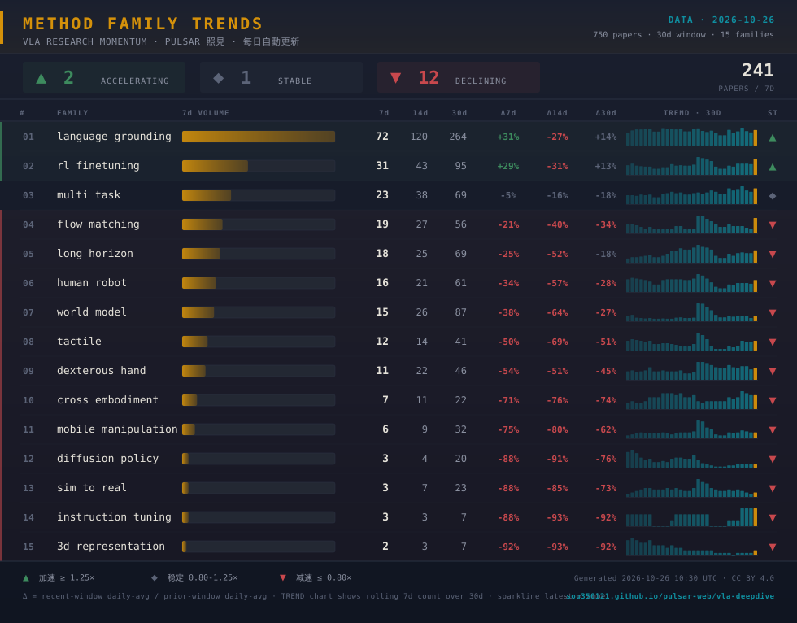

# Method Family Trends · VLA 方法族趋势

> 🖼️ **数据日期**: `2026-10-20` · **窗口**: 最近 `30` 天 · **累计论文**: `728` 篇 · **家族数**: `15`
>
> 每日自动生成 · 数据源 [pulsar-web vla-deepdive](https://sou350121.github.io/pulsar-web/vla-deepdive/)

---

## 📊 数据明细

| Family | 7d | 14d | 30d | Δ7d | Δ14d | Δ30d | Trend | Status |
|--------|:--:|:---:|:---:|:---:|:----:|:----:|:------|:------:|
| `language grounding` | 73 | 138 | 269 | ·  -16% | ·  -10% | 🟢 **+43%** | `▇▇▇▆▆▇█▆▆▇▆▅▅▇` | · ◆ |
| `multi task` | 23 | 37 | 61 | ·  +14% | ·  +5% | ·  -7% | `▆▅▆▅▅▅▆▅▆▇▆▅▅█` | · ◆ |
| `rl finetuning` | 18 | 51 | 81 | 🔴 **-59%** | 🟢 **+44%** | ·  -6% | `▅▄▄▄▄▅█▇▇▆▄▃▃▄` | 🔴 ▼ |
| `world model` | 14 | 63 | 79 | 🔴 **-79%** | 🟢 **+78%** | 🔴 **-41%** | `▁▂▂▂▂▂█▇▆▅▃▂▂▂` | 🔴 ▼ |
| `dexterous hand` | 14 | 29 | 43 | 🔴 **-31%** | ·  -18% | 🔴 **-35%** | `▄▄▄▃▃▃██▇▆▅▅▅▆` | 🔴 ▼ |
| `long horizon` | 13 | 36 | 63 | 🔴 **-58%** | ·  +2% | ·  -4% | `▅▅▆▆▆▆█▇▆▆▃▂▂▄` | 🔴 ▼ |
| `flow matching` | 11 | 31 | 41 | 🔴 **-59%** | ·  -12% | 🔴 **-38%** | `▂▃▃▂▂▂██▆▅▄▃▃▄` | 🔴 ▼ |
| `human robot` | 10 | 33 | 59 | 🔴 **-67%** | ·  -7% | ·  -10% | `▅▅▅▅▅▆█▇▆▄▃▂▂▃` | 🔴 ▼ |
| `mobile manipulation` | 6 | 23 | 34 | 🔴 **-74%** | 🔴 **-35%** | 🔴 **-48%** | `▂▂▃▃▃▃█▇▅▄▂▂▂▃` | 🔴 ▼ |
| `cross embodiment` | 6 | 9 | 21 | 🔴 **-70%** | 🔴 **-75%** | 🔴 **-68%** | `█▇█▆▆▇▄▃▄▄▄▄▄▆` | 🔴 ▼ |
| `tactile` | 5 | 26 | 39 | 🔴 **-82%** | 🔴 **-26%** | 🔴 **-41%** | `▃▃▂▂▂▃█▇▅▂▁▁▁▂` | 🔴 ▼ |
| `sim to real` | 5 | 16 | 25 | 🔴 **-75%** | 🔴 **-55%** | 🔴 **-62%** | `▃▄▃▃▃▄█▆▆▄▃▃▃▃` | 🔴 ▼ |
| `diffusion policy` | 2 | 9 | 22 | 🔴 **-90%** | 🔴 **-75%** | 🔴 **-66%** | `▆▆▆▆▆█▅▃▂▂▁▁▁▂` | 🔴 ▼ |
| `3d representation` | 1 | 2 | 8 | 🔴 **-95%** | 🔴 **-94%** | 🔴 **-88%** | `█▆▆▄▄▄▄▄▄▄▂▂▂▂` | 🔴 ▼ |
| `instruction tuning` | 1 | 3 | 5 | 🔴 **-95%** | 🔴 **-92%** | 🔴 **-92%** | `▄████████····▄` | 🔴 ▼ |

---

## 📖 图例说明

- **7d / 14d / 30d**：该家族近 7 / 14 / 30 天内出现的论文篇数
- **Δ7d / Δ14d / Δ30d**：近窗口与前一窗口每日平均的比值（>1.25 加速 / <0.80 减速）
- **Trend**：过去 14 天每天的 7 日滚动计数 sparkline
- **Status**：🟢 ▲ 加速 · · ◆ 稳定 · 🔴 ▼ 减速

## 🔗 相关资源

- 🌐 [Pulsar 照見 · VLA 深挖实时看板](https://sou350121.github.io/pulsar-web/vla-deepdive/)
- 📡 [RSS 订阅](https://sou350121.github.io/pulsar-web/subscribe/)
- 📊 [VLA 数据工程指南](../theory/foundation/vla_data_engineering_guide.md)

> 本快照由 `scripts/export-method-family-viz.py` 每日自动生成 · 最后更新 `2026-10-20 10:30 UTC` · CC BY 4.0
